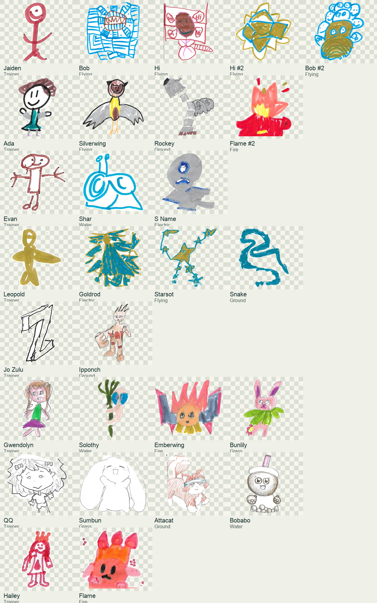

# Wednesday art class intake — October 14, 2026

20 distinct drawings by 8 children were added to Creature Battle. Each drawing retains its own stable ID and original colors. One reviewed trainer portrait is reused across each child’s creatures. The roster now has 23 real creatures from 9 artists including Uncle Mark; the six TEST creatures retire automatically.

The user authorized best decisions for ambiguous names/marks and confirmed that repeated trainer names belong to the same child. A later clarification requires repeated creature names to display with #2, #3, etc. All different pictures remain separate creatures.

| Trainer | Creatures |
| --- | --- |
| Jaiden | Bob, Hi, Hi #2, Bob #2 |
| Ada | Silverwing, Rockey, Flame #2 |
| Evan | Shar, S Name |
| Leopold | Goldrod, Starsot, Snake |
| Jo Zulu | Ipponch |
| Gwendolyn | Solothy, Emberwing, Bunlily |
| QQ | Sumbun, Attacat, Bobabo |
| Hailey | Flame |

## Stat cap

Each stat is an integer from 0 to 5. The sum must be at most 10; lower totals are accepted without filling unused points. All 20 imported class creatures currently total 10, and none exceeds the cap. Collection import and battle initialization both reject totals above 10.

## Interpretation decisions

Unmarked stats are zero when the marked stats already total 10. Clear cross-outs cancel earlier selections. Faint extra circles are resolved using the final marks and the ten-point budget. No drawings were redrawn. Template text that overlaps artwork is removed conservatively; source paper is retained inside reviewed open outlines.

| Creature | Decision |
| --- | --- |
| Bob | Four moves circled: retained Body Slam, Bubble Shield and Healing Glow; omitted Iron Hide to keep one attack and two distinct defenses. |
| Silverwing | Crossed-out stats canceled: health 5, attack 1, defense 2, speed 2. Final colored selections total 10. |
| Shar | Replacement drawing is on overlay paper; visible name reads Shar. Assigned to Evan using visible trainer name and matching portrait. Health 5 and speed 1/3/4/5 are canceled. |
| Goldrod | Gold rod normalized to Goldrod. Crossed-out health/defense/speed 5 canceled; attack 1 completes budget with final 2/4/3. Iron Hide crossed out. |
| Ipponch | Trainer handwriting interpreted as Jo Zulu; one stable identity. |
| Starsot | Creature name transcribed as Starsot. Trainer Leopold spelling consolidated with other two drawings. |
| Hi | Bubble Shield crossed out. Unmarked attack is 0; remaining selected stats total 10. |
| Snake | Tree crossed out; replacement name sake interpreted as Snake from the snake drawing. Health 1 crossed out; active health 4. |
| Rockey | Crossed-out earlier creature name omitted; Rockey is the active name. |
| Solothy | Name reads Solothy. Speed unmarked; selected health/attack/defense already total 10, so speed is 0. |
| Emberwing | Defense 1 is the stronger final circle and yields budget 10. Tackle has a pencil cross-out; retained Quick Strike, Healing Glow and Iron Hide. |
| Bunlily | Flower rabbit name interpreted as Bunlily. Strong health 3 circle used over faint health 4; final total is 10. |
| Sumbun | Name transcribed as Sumbun. Trainer QQ shared across all three matching portraits. |
| Flame | Crop isolates the actual creature from the habitat illustration and campfire. Moves indicated by yellow highlighting. |
| Attacat | Kept oversized tail and feet extending past frame; printed heading/frame removed with reviewed masks. |
| Bobabo | Uppercase BOBABO normalized to Bobabo. Dark circles chosen over faint previous circles; stats total 10. |
| Hi #2 | Distinct gold geometric Hi drawing. Unmarked defense and speed are 0; health/attack total 10. |
| Bob #2 | Distinct gold-and-blue Bob drawing. Unmarked defense and speed are 0; health/attack total 10. |
| Flame #2 | Mega Burst crossed out. Trainer Ada grouped with Silverwing and Rockey. |
| S Name | Visible name S. name normalized to S Name because game names do not support periods. Attack 4 and 5 crossed out; active attack 3. |

## Review and reproduction

The original scans stay in the source folder. Their filenames, crop coordinates, upright rotations, selected/canceled marks and decision notes are recorded in `wed-art-2026-10-14.json`. The original base names are stored in the shared data file for cached-client compatibility; the current loader displays repeated names as Bob #2, Hi #2 and Flame #2.

Run the importer against the original scan folder with the reviewed manifest. Inspect the generated cutouts before using `--publish --reviewed`. The local roster update uses the existing validated, rollback-safe publisher.

